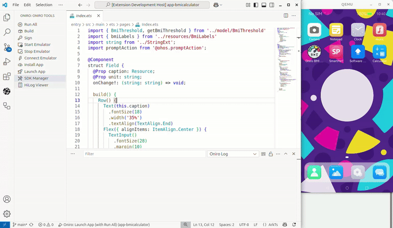

# Oniro App IDE

Oniro App IDE is a lightweight IDE, as a Visual Studio Code extension, for Oniro/OpenHarmony and HarmonyOS application development. It covers the whole loop: create a project, check and build it, sign it, run it on a device or the Oniro emulator, follow its log, run its tests and explain its crashes. It also manages the SDKs, the command-line tools and the emulator.

Under the hood it uses [`@oniroproject/core`](https://www.npmjs.com/package/@oniroproject/core), the library behind the [`oniro-app`](https://www.npmjs.com/package/@oniroproject/oniro-app) CLI, so the extension and the CLI behave the same way and share their installs, signing material and Huawei sign-in.



## Features

### Build and check
- **Run** (`Ctrl+F5`, or the ▶ button in the Oniro view and on `.ets` editors): builds, installs and launches the app on the target device, then opens the HiLog viewer on its process. When no device is connected it starts the Oniro emulator and waits until it has booted.
- **Build**, with errors and warnings in the **Problems panel**: ArkTS compiler and linter errors, hvigor configuration errors, native (clang/lld) errors and ohpm errors, each at its file and line. When the project's SDK is not installed, the build offers to install it. **Build…** lets you pick the product, module and build mode.
- **Check ArkTS**: the SDK's own ArkTS type check and linter, plus the ArkUI rules hvigor enforces later, in seconds and without a build. **Fix ArkTS Problems** applies the fixes the checker can verify. Turn on `oniro.checkArktsOnSave` to check each `.ets` file when you save it.
- **Tasks**: `oniro: build` (offered by **Run Build Task**, `Ctrl+Shift+B`) and `oniro: check ArkTS`, both reporting to the Problems panel.

### Sign
- **Sign Project**: offline OpenHarmony development signing configs. For a HarmonyOS product (`runtimeOS: "HarmonyOS"`), it gets a debug certificate and profile from AppGallery Connect with your Huawei developer account (**Sign In to Huawei Developer Account**; the sign-in is shared with `oniro-app auth login`).
- **Sign HAP…** and **Verify HAP Signature…**: sign a prebuilt `.hap` with no project, or check what signed one (certificate chain, profile type, bundle, APL, devices and expiry). Both are also in the Explorer context menu on `.hap` files.

### Run on a device
- **Target device** in the status bar and the sidebar: pick which connected device (or emulator) the commands use. The choice is also exported to integrated terminals as `ONIRO_DEVICE_SERIAL`, so `oniro-app` run there targets the same device.
- **Install**, **Launch**, **Stop** and **Uninstall** the app. When the installed copy was signed with other material, Install offers to uninstall it first instead of failing.
- **Take Device Screenshot**: opens the capture in an editor tab, with Save As.
- **HiLog Viewer**: real-time device log, filtered by process, level, tag and message.
- **Show Last Crash**: fetches the app's newest fault log (JS crash, native crash or app freeze) and explains it: the reason, the error and stack, and a link to the first line of **your** code involved, which is also opened in the editor.

### Test
- **Test Explorer** integration for `ohosTest` suites: suites and cases are read from `src/ohosTest`, and running them builds the main and test HAPs, installs both and runs the selected suites on the device with `aa test`. Failures link to the assertion's line.

### Emulator and SDKs
- **Emulator**: start (waiting for boot to complete), stop and connect, with its status in the sidebar. On Apple Silicon and arm64 Linux the arm64 Oniro emulator is installed.
- **SDK Manager**: install and remove OpenHarmony SDKs, the command-line tools (with their version and edition) and the emulator. **Install from archive…** installs a local SDK `.tar.gz`, such as the full SDK (with system APIs) from the OpenHarmony daily builds. The HarmonyOS SDK in use is shown too.
- **Doctor**: one verdict on whether this machine can build, sign, install and test the project (node, java, SDK, command-line tools and their edition, the ArkTS checker, hdc, the device, signing material, disk space), with a fix for each problem. Results also appear in the sidebar.

### Write code
- **ArkTS language support**: syntax highlighting, completion, navigation and diagnostics for `.ets` files against the project's SDK.
- **Search SDK API**: ranked search of what the project's SDK declares (ArkTS APIs, ArkUI components and decorators, Node-API), with the kit, `@since`, deprecation and how to import each symbol. Open the declaration, or insert its import into the current file.
- **Search OpenHarmony Docs**: full-text search of the application-development documentation of the release your SDK belongs to, opened in the Markdown preview. The docs are downloaded on first use (a partial clone of about 100 MB; needs `git`).
- **Create Project** from the Empty Ability, Native C++ or HarmonyOS App template.

## Requirements

- Java (for signing)
- QEMU (for the Oniro emulator)
- git (only for Search OpenHarmony Docs)

The OpenHarmony SDK, the command-line tools and the emulator can all be installed from the SDK Manager. Run **Oniro: Run Doctor** to check the setup.

## Installation

### From Marketplace / Open VSX

Install Oniro App IDE from either:
- Visual Studio Code Marketplace: https://marketplace.visualstudio.com/items?itemName=oniro.oniro-app-ide
- Open VSX Registry (for VSCodium / compatible IDEs): https://open-vsx.org/extension/oniro/oniro-app-ide

### From Source (Development)

```bash
git clone https://github.com/eclipse-oniro4openharmony/oniro-vscode-ext.git
cd oniro-vscode-ext
npm install
npm run compile
code .
# Press F5 to start the Extension Development Host
```

Tests:

```bash
npm test                    # unit tests and activation (no SDK or device needed)
npm run test:integration    # against the real toolchain: SDK API 23, command-line tools,
                            # java, and a running Oniro emulator (device tests install,
                            # launch and crash a test app; to use another device, set
                            # ONIRO_TEST_DEVICE_SERIAL)
```

On Linux without a display, prefix them with `xvfb-run -a` (and unset `WAYLAND_DISPLAY` under a Wayland session).

## Usage

1. Open the **Oniro** view in the activity bar.
2. Install what you need from the **SDK Manager**, or run **Doctor** to see what is missing.
3. **Create Project**, or open an existing OpenHarmony/HarmonyOS project (a folder with `build-profile.json5`).
4. Press **Run** (`Ctrl+F5`). The first build offers to create signing configs when the project has none.

All commands are in the Command Palette under **Oniro:**.

## Extension Settings

| Setting | Default | Description |
|---|---|---|
| `oniro.sdkRootDir` | `${userHome}/setup-ohos-sdk` | Where OpenHarmony SDKs are installed. |
| `oniro.cmdToolsPath` | `${userHome}/command-line-tools` | Where the command-line tools are installed. |
| `oniro.emulatorDir` | `${userHome}/oniro-emulator` | Where the Oniro emulator is installed. |
| `oniro.emulatorUrl` | *(empty)* | Emulator archive URL. Empty: the latest release for this machine's architecture. |
| `oniro.cmdToolsUrlLinux` / `…Windows` / `…Mac` | *(empty)* | Command-line tools download URL per OS. Windows and macOS builds must be downloaded by hand; the SDK Manager then asks for the ZIP. |
| `oniro.hapPath` | *(empty)* | HAP to install, relative to the project. Empty: what the last build produced. |
| `oniro.hdcPath` | *(empty)* | hdc binary. Empty: the one in the command-line tools or SDK. |
| `oniro.harmonyosSdkPath` | *(empty)* | HarmonyOS SDK location. Empty: DevEco Studio or the HarmonyOS command-line tools, found automatically. |
| `oniro.sdkUrlBase` | *(empty)* | OpenHarmony SDK mirror. Empty: Huawei Cloud. |
| `oniro.docsDir` | *(empty)* | Where Search Docs downloads the docs. Empty: `<sdkRootDir>/docs`. |
| `oniro.tmpDir` | *(empty)* | Scratch space for downloads and extraction. Empty: `.oniro-tmp` next to the install target. |
| `oniro.emulatorBootTimeout` | `240` | Seconds to wait for the emulator to boot. |
| `oniro.checkArktsOnSave` | `false` | Check each saved `.ets` file with the ArkTS checker. |
| `oniro.openHilogOnLaunch` | `true` | Open the HiLog viewer on the app after launching it. |
| `ets.linterVersion` | `1.1` | ArkTS linter version used by the language server (`off` disables it). |

## `launch.json`

To run the app with F5, add an `oniro-debug` configuration. It runs **Oniro: Run** (there is no ArkTS debugger yet, so no debug session is started):

```json
{
    "version": "0.2.0",
    "configurations": [
        { "name": "Run Oniro App", "type": "oniro-debug", "request": "launch" }
    ]
}
```

## Known Issues

- Command-line tools 6.1.1 (hvigor 6.24.2) cannot build projects targeting OpenHarmony API 26 (7.0). Create Project therefore defaults to the newest installed SDK the installed tools can build.
- HarmonyOS signing and the Windows/macOS flows have not been validated end to end from the extension yet.

Please report issues and feature requests on the GitHub repository.

## For more information
- [Oniro Project](https://oniroproject.org/)
- [OpenHarmony Documentation](https://www.openharmony.cn/en/)
